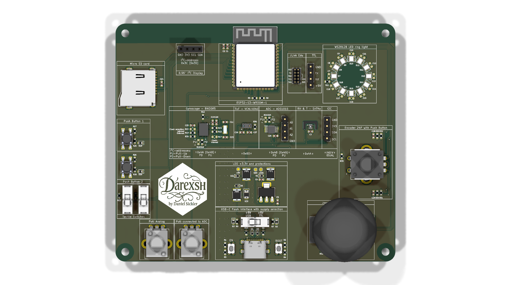
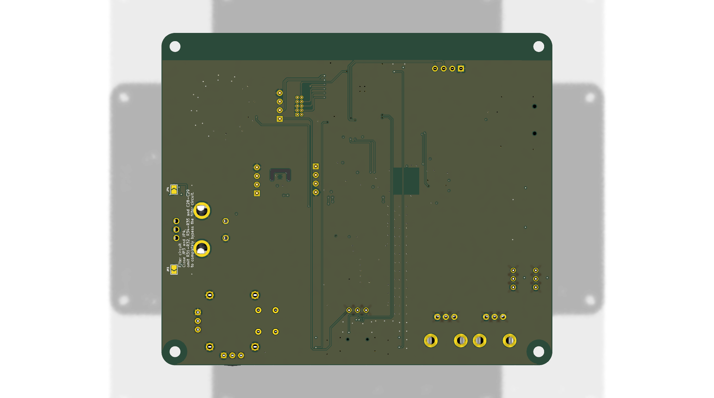

* * *

<div align="center">

🧩 ESP32-S3 Mentoring Board
==========================

**A multi-function mentoring/training board with ESP32-S3, common sensors, inputs, and LEDs**  
🧠🛠️🎛️💡📦


  

[](https://t.me/darexsh_bot) [](https://buymeacoffee.com/darexsh)  
<sub>Check out my bot in Telegram for an easy project overview.<br>If you want to support more projects, you can leave a small donation for a coffee.</sub>


</div>

* * *

✨ Authors
---------

| Name | GitHub | Role | Contact | Contributions |
| --- | --- | --- | --- | --- |
| **[Darexsh by Daniel Sichler](https://github.com/Darexsh)** | [Link](https://github.com/Darexsh?tab=repositories) | Hardware & Firmware Development 🖥️🛠️ | 📧 [E-Mail](mailto:sichler.daniel@gmail.com) | Concept, Hardware, Firmware, Board Bring-up |

* * *

🚀 About the Project
--------------------

This project is a **mentoring/training board** based on the ESP32-S3 microcontroller. It combines common sensors, inputs, LEDs, and storage so embedded features can be demonstrated and tested on a single board.

### 🛠️ Technologies

* **Microcontroller:** ESP32-S3-WROOM-1-N8R8  
* **Sensors:** VCNL4040 (ambient light & proximity), SHT4x (temperature & humidity), BNO085 (IMU), ADS1015 (ADC)  
* **Inputs:** push buttons, tactile switches, potentiometers, joystick, rotary encoder  
* **Outputs:** WS2812B-2020 addressable LEDs  
* **Storage:** microSD card (SPI)  
* **Display:** I2C display header  
* **Software:** C++, Arduino framework (PlatformIO)  
* **Tools:** KiCad, PlatformIO, Git  

* * *

📋 Features
===========

* **🧭 Sensor Demonstrations:** IMU, proximity/light, temperature/humidity, external ADC  
* **🎛️ Input Practice:** buttons, tactile switches, potentiometers, joystick, encoder  
* **💡 LED Control:** WS2812B addressable LEDs  
* **📦 Data Logging:** microSD over SPI  
* **🖥️ Optional I2C Display:** header for showing sensor values  
* **🧩 Modular Firmware:** enable features via compile-time flags  

* * *

🔧 Hardware Setup
-----------------

* **ESP32-S3 module**  
* **VCNL4040, SHT4x, BNO085, ADS1015** on I2C  
* **WS2812B-2020 LED chain**  
* **microSD socket** over SPI  
* **Joystick, potentiometers, buttons, encoder** for user input  
* **I2C display connector**  

* * *

🚀 Installation & Usage
-----------------------

1. Open the KiCad project in `Hardware/` if you want to inspect or modify the hardware.  
2. Build and flash the firmware with PlatformIO:  
   
   ```bash
   cd Software
   pio run -t upload
   pio device monitor
   ```
3. Enable/disable features in `Software/lib/select_sensory/select_sensory.h`.  

* * *

## 📜 License

This project is licensed under the **MIT License**.

This license applies to the updater application code in this repository. Upstream patch and app projects remain under their own licenses and notice terms.

**Copyright (c) 2025 Darexsh by Daniel Sichler**

You are free to use, copy, modify, merge, publish, distribute, sublicense, and sell this software under the terms of the MIT License.

When redistributing this project, you must include the original copyright notice and the MIT License permission notice.

**Developer:** Darexsh by Daniel Sichler.

The full license is available in the [LICENSE](LICENSE) file.

* * *

<!-- Keep this line! Rendered picture of PCB is going to be displayed after Production files are pushed to branch! -->



<div align="center"> <sub>Created with ❤️ by Daniel Sichler</sub> </div>
